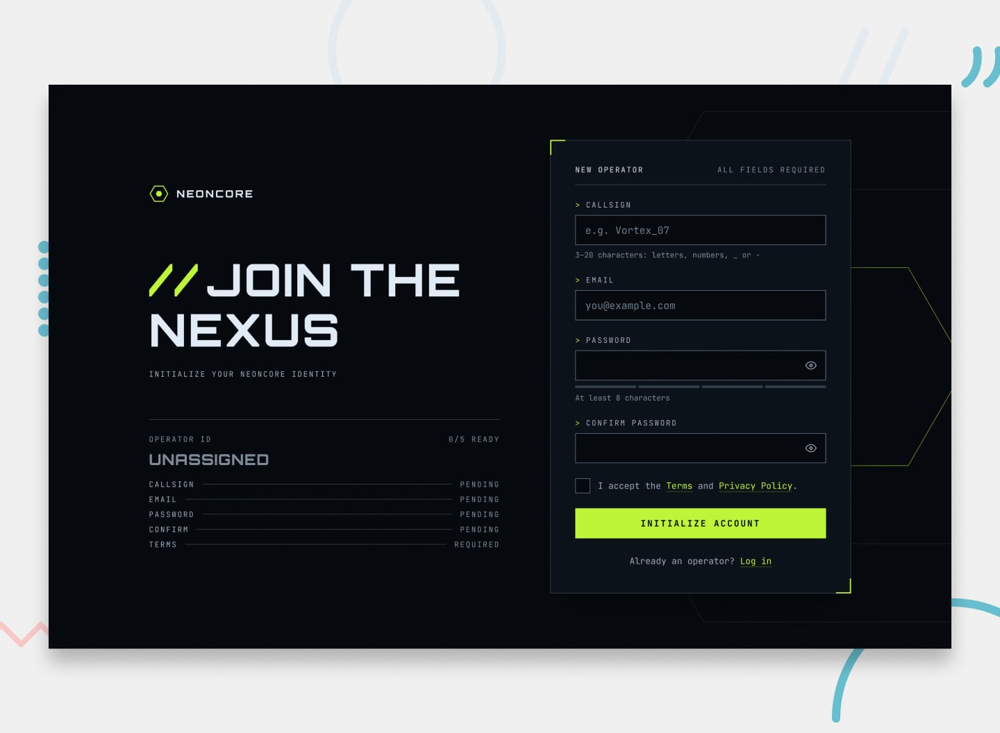

# Frontend Mentor - Gamer sign-up form

## Welcome! 👋

Thanks for checking out this coding challenge.

[Frontend Mentor](https://www.frontendmentor.io) challenges help you improve your coding skills by building realistic projects.

**To do this challenge, you need a basic understanding of HTML, CSS and JavaScript.**

## The challenge

Build a sign-up form for NEONCORE, a competitive-gaming network, and get it looking as close to the design as possible.

Most of the work is in the form's states. Every field validates, the password field has a strength meter and a show/hide button, and the submit button has loading and success states. Building all of that so it works for keyboard and screen reader users is the real practice here.

You can use any tools you like to help you complete the challenge. So if you've got something you'd like to practice, feel free to give it a go.

Your users should be able to:

- Fill in the form with a callsign, email, password, and password confirmation, and accept the terms
- Receive form validation messages if:
  - Any field is missed
  - The callsign is shorter than 3 characters, longer than 20, or uses anything other than letters, numbers, `_` or `-`
  - The email address is not formatted correctly
  - The password is shorter than 8 characters
  - The passwords don't match
  - The terms checkbox isn't ticked
- Show and hide each password with the eye button
- See a password strength meter update as they type
- See a loading state on the button while the form submits, then a success message
- Complete the form only using their keyboard
- Have inputs, hints, error messages, and the success message announced on their screen reader
- View the optimal layout for the interface depending on their device's screen size
- See hover and focus states for all interactive elements on the page

The Operator ID readout beside the form on desktop is an optional extra. It mirrors what's happening in the form, so you can build it once the form itself works.

## How the form behaves

The designs show each state, but a still image can't show when one state turns into the next. Here's how the form should behave.

### When fields are checked

- A field is checked when it loses focus with something in it. Leaving a field that was never filled shows nothing.
- Once a field has been checked, it re-checks on every keystroke. An error clears as soon as it's fixed, and the check icon appears as soon as the value is valid.
- Before a field has been checked, its empty-field message only appears on submit.
- Trim the callsign before checking it, so a callsign of only spaces counts as empty.
- Typing in the password re-checks the confirm field, if that has already been checked.
- The terms error only appears on submit, and clears as soon as the checkbox changes.

### Password strength

- The meter updates from the first character as the user types. An empty field shows no segments and no label.
- A password under 8 characters is always Weak.
- From 8 characters, score one point each for: 8 or more characters, 12 or more characters, both uppercase and lowercase letters, a number, and a symbol. Cap the score at 4: 1 is Weak, 2 is Fair, 3 is Good, and 4 is Strong.
- For example, `neoncore` is Weak, `neoncore99` is Fair, `Neoncore99` is Good, and `Tr4nsm1t!Nexus` is Strong.
- Strength is advice only. The one password rule is 8 or more characters.

### Submitting

- On an invalid submit, check every field, move focus to the first invalid one, and announce how many fields need attention, for example "3 fields need attention".
- On a valid submit, hide any revealed passwords, lock the fields, and show `Transmitting_` on the button. There's no server for this challenge, so wait a moment before showing the success message.
- On success, the success message replaces the form in the same panel, and focus moves to the success heading.

## Ideas to test yourself

The design gives you plenty to build. If you want to push further, here are some optional extensions to try:

- Build the Operator ID readout so it updates as each field passes or fails
- Shake the panel on an invalid submit, and turn the motion off for users who prefer reduced motion
- Animate the hex check on the success screen so it draws itself in
- Warn users when Caps Lock is on while they type a password
- Style the browser's autofill, text selection, and scrollbar to match the dark theme
- Build a matching log-in form that reuses your field, button, and error styles

## Getting started

### What's included

Your task is to build out the project to the designs inside the `/design` folder. You'll find a mobile and a desktop version of the design, plus the error, filled, and success states, the password strength and password visible states, the submitting state, and the hover and focus states.

In your download:

- Mobile and desktop designs (JPG format)
- All required assets in the `/assets` folder
- Variable and static font files (or link to Google Fonts)
- `style-guide.md` with colors, fonts, and other design specs

**Want more accurate builds?** The designs are in JPG static format, which means you'll need to use your best judgment for styles such as `font-size`, `padding`, and `margin`. If you'd like the Figma design file to help build a more accurate solution faster, you can [subscribe as a PRO member](https://www.frontendmentor.io/pro).

## Using AI coding assistants

We've included two files to help you if you're using AI coding assistants (like Claude, GitHub Copilot, Cursor, etc.) while working on this challenge:

- `AGENTS.md` - Contains detailed instructions for AI assistants on how to help you with this challenge. It's tailored to this challenge's difficulty level, so the AI will provide guidance appropriate to your learning stage—offering more support for beginner challenges and encouraging more independence on advanced ones.
- `CLAUDE.md` - A pointer file that directs Claude-based tools to the AGENTS.md instructions.

**How to use them:** You don't need to do anything! These files are automatically detected by most AI coding tools. The AI will read them and adjust its behavior to be a better learning partner—guiding you toward solutions rather than just giving you the answers.

**Note:** These files are designed to help you *learn*, not to do the work for you. The AI is instructed to ask questions, give hints, and explain concepts rather than writing complete solutions.

## Building your project

Feel free to use any workflow that you feel comfortable with. Below is a suggested process, but do not feel like you need to follow these steps:

1. Initialize your project as a public repository on [GitHub](https://github.com/). Creating a repo will make it easier to share your code with the community if you need help. If you're not sure how to do this, [have a read-through of this Try Git resource](https://try.github.io/).
2. Configure your repository to publish your code to a web address. This will also be useful if you need some help during a challenge as you can share the URL for your project with your repo URL. There are a number of ways to do this, and we provide some recommendations below.
3. Look through the designs to start planning out how you'll tackle the project. This step is crucial to help you think ahead for CSS classes to create reusable styles.
4. Before adding any styles, structure your content with HTML. Writing your HTML first can help focus your attention on creating well-structured content.
5. Write out the base styles for your project, including general content styles, such as `font-family` and `font-size`.
6. Start adding styles to the top of the page and work down. Only move on to the next section once you're happy you've completed the area you're working on.

### Want some support on the challenge?

[Join our community](https://www.frontendmentor.io/community) and ask questions in the **#help** channel.

## Deploying your project

As mentioned above, there are many ways to host your project for free. Our recommended hosts are:

- [GitHub Pages](https://pages.github.com/)
- [Vercel](https://vercel.com/)
- [Netlify](https://www.netlify.com/)

You can host your site using one of these solutions or any of our other trusted providers. [Read more about our recommended and trusted hosts](https://www.frontendmentor.io/guides/hosting-your-solution).

## Submitting your solution

Submit your solution on the platform for the rest of the community to see. Follow our ["Complete guide to submitting solutions"](https://www.frontendmentor.io/guides/how-to-submit-solutions) for tips on how to do this.

Remember, if you're looking for feedback on your solution, be sure to ask questions when submitting it. The more specific and detailed you are with your questions, the higher the chance you'll get valuable feedback from the community.

**We strongly recommend overwriting this `README.md` with a custom one.** We've provided a template inside the [`README-template.md`](./README-template.md) file in this starter code. The template provides a guide for what to add. A custom `README` will help you explain your project and reflect on your learnings.

## Sharing your solution

There are multiple places you can share your solution:

1. Submit it on the platform and share your solution page in the **#finished-projects** channel of our [community](https://www.frontendmentor.io/community)
2. Share on [X (formerly Twitter)](https://x.com/frontendmentor) and mention **@frontendmentor**, including the repo and live URLs in your post. We'd love to take a look at what you've built and help share it around.
3. Share your solution on [LinkedIn](https://www.linkedin.com/company/frontend-mentor/).
4. Blog about your experience building your project. Writing about your workflow, technical choices, and talking through your code is a brilliant way to reinforce what you've learned. Great platforms to write on are [dev.to](https://dev.to/), [Hashnode](https://hashnode.com/), and [CodeNewbie](https://community.codenewbie.org/).

## Got feedback for us?

We love receiving feedback! We're always looking to improve our challenges and our platform. So if you have anything you'd like to mention, please email hi[at]frontendmentor[dot]io.

**This challenge is completely free. Please share it with anyone who will find it useful for practice.**

**Have fun building!** 🚀
